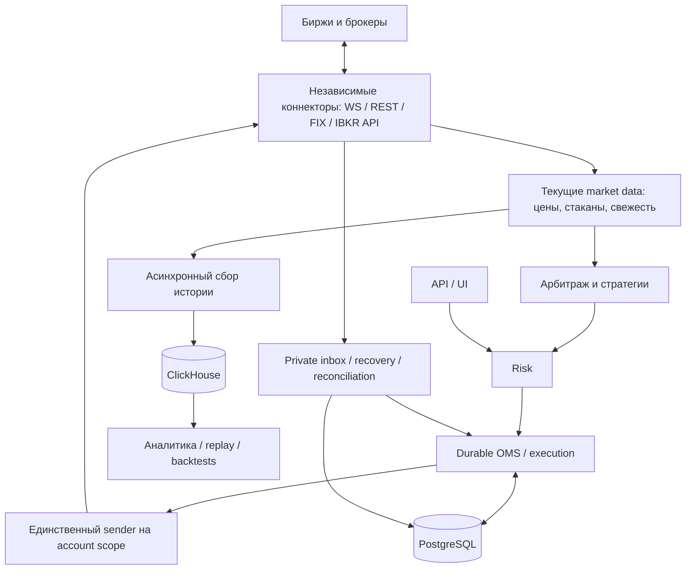

# Целевая архитектура TradeOps

Решение владельца от **2026-11-04**. Канонический документ для всего проекта и последующих изменений. Ссылки: [инструкции проекта](../../AGENTS.md), [этапы разработки и текущие gates](../orchestration/INSTITUTIONAL_PLATFORM_MASTER_ROADMAP_2026-10-25.md).

## Цель и способ развития

TradeOps должен вырасти в большую арбитражную платформу с 10–20 коннекторами к биржам и брокерам. WebSocket, REST, FIX 4.4, собственный API Interactive Brokers и будущие протоколы реализуются внутри соответствующих коннекторов. Несколько протоколов одной площадки не означают несколько независимых владельцев её ордеров.

Строим модульное приложение с явными контрактами и проверяемыми границами кода. На ранних этапах модули могут работать в общих процессах; коннекторы, market data, стратегии или аналитика смогут выноситься в отдельные процессы по потребности в задержках, ресурсах и изоляции отказов. Вынос потребует транспорта, supervision, наблюдаемости и проверок отказов, но не должен требовать переписывания торговой модели. Обещание полностью бесплатного перехода к распределённой системе было бы неверным.

**V2 поставляет только Deribit**, включая обязательный FIX 4.4 через QuickFIX/n. Остальные площадки — V3. Общие границы закладываются сейчас; другие коннекторы и ClickHouse сейчас не разворачиваем. Наличие legacy-адаптеров не означает их квалификации.

## Границы ответственности

| Модуль | Что ему принадлежит | С чем он взаимодействует |
|---|---|---|
| Коннектор площадки | Аутентификация, протоколы и сессии, heartbeat/reconnect, rate limits, native IDs и преобразование сообщений, правила/возможности площадки | Контракты приложения и домена; транспорт площадки |
| Текущие рыночные данные | Нормализованные quotes/trades/books, instrument metadata, последовательность и свежесть данных | Market-data ports коннекторов, стратегии и UI |
| Арбитраж и стратегии | Сравнение доступных цен с учётом комиссий, ликвидности и ограничений; торговые намерения | Рыночные данные, порт отправки намерений через risk/OMS |
| Risk | Предторговые лимиты, резервирование экспозиции, kill switch, блокировки при недостоверном состоянии | OMS и проверенные account/position/market read models |
| OMS и execution | Durable intent/command/outbox, жизненный цикл ордеров и fills, аудит, единственный физический sender | PostgreSQL, risk, order-entry ports коннекторов |
| Private ingestion и recovery | Scoped inbox/dedup/quarantine, snapshots/history/fills, reconciliation после gaps/restarts | Private/recovery ports коннекторов, OMS |
| История и аналитика | Исторические market datasets, исследования, replay/backtests | Асинхронный сбор данных, ClickHouse; стратегии через отдельный research/replay режим |
| API/UI | Аутентификация пользователя, выбор scope, команды и отображение read models | Прикладные порты; не прямое изменение состояния ордеров |

Стрелка от коннектора к данным означает передачу наблюдений через порт, а не зависимость коннектора от реализации OMS или БД. Высокочастотные рыночные данные и аналитические записи не должны задерживать private ingestion, risk или отправку ордеров. Очереди ограничены; потери и устаревание обнаруживаются явно.

## Контракты и зависимости

Целевое направление: `Domain ← Application contracts ← Connectors.<Venue>` и `Domain/Application ← Infrastructure.Persistence`; hosts собирают реализации через DI. Коннектор не ссылается на Infrastructure, EF/Npgsql, другой коннектор, UI или стратегию. Прикладное ядро не ссылается на коннекторы. Не переносить persistence или стратегии в коннектор ради удобства.

Порты разделяются по обязанностям: market data, private executions, order entry, recovery queries, venue capabilities и instrument rules. Существующий широкий `IExchangeClient` — legacy, а не эталон нового универсального интерфейса. Новые общие контракты должны учитывать:

- полный `tenant + venue + environment + account + optional subaccount` scope;
- собственные и native identifiers, явные units/currency и instrument metadata; одинаковый symbol или числовой ID не устанавливает тождество;
- venue timestamp, receive time, session/stream epoch и происхождение наблюдения;
- возможности конкретного venue/протокола и явный отказ для неподдерживаемых операций; семантика cancel/replace, amount и order types не унифицируется выдуманными значениями;
- версии и совместимость durable schemas; нормализация не стирает необходимые native facts.

Нельзя объявлять Deribit-specific DTO общим только сменой имени или удалением проверки venue. Уже сохранённые v1/v2 payloads, namespaces и hashes остаются совместимыми; развитие общего формата требует отдельного versioned решения и replay/compatibility проверок.

## Торговые инварианты

Стратегия и UI подают намерение через risk и durable OMS. Прямые placement/cancel/replace через коннектор в обход этого пути запрещены. Намерение записывается до отправки. Потеря ACK после возможной отправки означает UNKNOWN/AMBIGUOUS; blind resend запрещён, ACK не доказывает fill.

На venue/account/environment работает один физический владелец отправки, с учётом subaccount и фактической области credentials. Несколько transport-сессий должны координироваться этим владельцем. Lease в PostgreSQL сам по себе не обеспечивает physical-send fencing. Старый процесс не должен сохранять возможность отправки после смены владельца.

После disconnect/restart/gap/account switch состояние остаётся RECOVERING/RECONCILING до coherent snapshots, history/fills и replay соответствующего epoch. Отсутствие ордера в open-orders не доказывает cancel. Late fills и cancel/replace races не теряют исполнение. Текущий capture coordinator — только барьер capture scope/epoch, не sender fencing и не доказательство readiness.

Многоногий арбитраж в будущем использует явную saga с лимитом остаточной экспозиции, hedge/unwind и восстановлением. Исполненную сделку нельзя атомарно «откатить» на другой бирже.

## Хранилища

**PostgreSQL** — транзакционный источник истины для локальных intents, commands, orders/fills, inbox/outbox, risk state и audit. Биржа остаётся внешним источником наблюдаемых фактов об исполнении.

**ClickHouse** — отдельная колоночная аналитическая SQL-база для больших исторических рядов: ticks, L2, trades, funding/basis и replay datasets. Запись асинхронна; её задержка или отказ не блокирует критический execution/private path. ClickHouse не назначается источником текущего статуса ордера. Для текущей возможности арбитража используются live данные с проверкой свежести и последовательности, а не запрос исторической базы. ClickHouse предусмотрен этапом market data/analytics и пока не развёрнут.

## Текущее состояние и последовательность

Исходная система — layered shared core (`Domain`, `Application`, `Infrastructure`) с несколькими hosts (`Api`, `Worker`, отдельный `TerminalApi`), а не завершённая микросервисная платформа. B1 contracts и B2 DB-only journal проверены; legacy runtime ещё не полностью переведён на них. B3 durable capture и read-only lifecycle проверены offline/loopback/PG, без автоматического включения в работающий host и без trading readiness.

Первый практический шаг реализован: существующий Deribit WS/private transport и parser выделены в отдельную сборку `TradeOps.Connectors.Deribit`. [Отчёт о границе модуля и проверках](../orchestration/workstreams/B3_01_CONNECTOR_BOUNDARY_2026-11-04.md). Legacy REST и сборка DI пока остаются в Infrastructure. Это частичное выделение, не утверждение, что весь Deribit уже изолирован. Текущие capture v2 и coordinator всё ещё имеют явно ограниченную Deribit-семантику; общий multi-venue контракт остаётся отдельной задачей.

Доверенная привязка и отдельный opt-in [read-only host B3](DERIBIT_READONLY_CAPTURE_HOST.md) реализованы; по умолчанию он не выбран. Отдельный [live protocol probe](DERIBIT_PRIVATE_SESSION_PROBE.md) квалифицировал quiet WSS session (auth/pin/subscribe/heartbeat), без БД и без production binding. Далее: live WS→durable inbox qualification B3; B4 coherent recovery/projection; B5 risk и sender fencing; B6 обязательный Deribit FIX. После безопасной Deribit V2 — остальные venues, multi-leg saga, market history/ClickHouse, scanners и replay/strategies по roadmap. При каждом шаге сохранять описанные границы вместо накопления нового общего venue-specific кода в Infrastructure.

Изменения этого решения отмечать здесь и в актуальной части roadmap. Проверенные результаты отдельных итераций хранить в workstream reports; не заменять архитектурный документ архивом чата.
