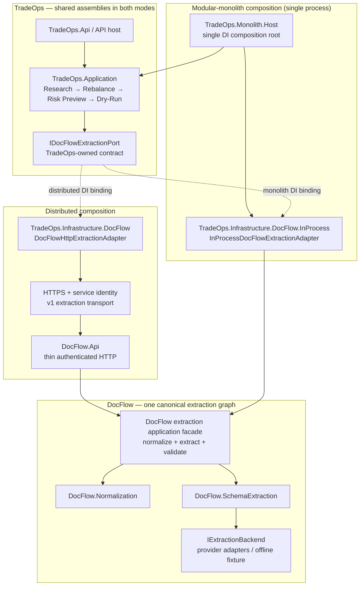

# TO-V2-01A — Dual-Topology Architecture & Packaging Decision

Status: **PROPOSED / DESIGN COMPLETE / ORCHESTRATOR APPROVAL REQUIRED**  
Workstream: **TO-V2-01A**, design-only; no runtime code, CI, project or solution edits.  
Repository / branch: `avysotsky/TradeOps-v2` / `TradeOps/to-v2-01a-dual-topology-design`  
Review: [TradeOps-v2 Draft PR #2](https://github.com/avysotsky/TradeOps-v2/pull/2)  
Observed baseline: TradeOps-v2 `main=b2bee7a3d6d57831bc2ba53c56d30e100cb8cfbb`, DocFlow-v2 `main=eb7280306785fe52c1228fe3829e415edd01fa8e` (2026-10-09). Refresh before integration.

## 1. Decision record

**ADR TO-V2-01A (proposed):** retain two private bounded-context repositories and two independently deployable HTTP services, while making the **same DocFlow native .NET application operation** available to a third *composition mode* in a single ASP.NET Core process. TradeOps application calls its **existing** `TradeOps.Application.Models.IDocFlowExtractionPort`; only composition selects HTTP or direct managed-code adapter. Keep all TradeOps research, rebalance, risk and dry-run services unchanged between topologies.

- **Selected initial integration technique:** local cross-repository `ProjectReference` via a developer-only aggregate solution/workspace to validate the seam, followed by **versioned, immutable private NuGet packages** for repeatable deployments and CI. The aggregate solution and future host live under TradeOps-v2 as a build/composition concern; no third repository, git submodule, copied DocFlow sources or vendored code.
- **Selected production packaging direction:** DocFlow-v2 builds/owns `DocFlow.Normalization`, `DocFlow.SchemaExtraction` and its future extraction application facade/provider adapter assemblies. Separate stable `DocFlow.Contracts` only when it meaningfully reduces outward coupling; do not prematurely package the existing persistence-oriented `DocFlow.Application` as if it already were the extraction entrypoint.
- **Selected host direction:** evolve existing `TradeOps.Api` and `DocFlow.Api`; add a narrowly scoped `TradeOps.Monolith.Host` *inside TradeOps-v2* only after composition is proven. A combined host may initially reuse TradeOps API routing plus internal DocFlow services; do not publish duplicate/bypassing DocFlow endpoints automatically.
- **Default until all gates pass:** existing isolated DocFlow HTTP adapter and Python/CLI reference paths remain operational for development/regression **only within authorized private network controls**. Native extraction, native HTTP host and in-process equivalence are **not** certified today.
- **Decision authority:** Development Orchestrator approves/contracts, schedules workers and merges; this document proposes, but does not authorize production exposure or trading execution.

### 1.1 Actual implementation inventory, not aspirational class names

| Concern | Confirmed today in pinned private `main` | Consequence |
|---|---|---|
| TradeOps port | `src/TradeOps.Application/Models/DocFlowExtractionContracts.cs`: `IDocFlowExtractionPort.ExtractAsync(DocFlowExtractionRequest, CancellationToken)`; request wraps `JsonElement RawDocument`, `SchemaRequest`, `Provider`, `Model`, optional `DocumentName`; result is two JSON strings | Preserve this binary/source-facing seam for the first in-process adapter. No DocFlow types in TradeOps.Application or Domain |
| TradeOps HTTP adapter | `src/TradeOps.Infrastructure/DocFlow/DocFlowHttpExtractionAdapter.cs`, `DocFlowServiceCollectionExtensions.cs`; POST `api/v1/extractions`, v1 envelope, 1 MiB request, 2 MiB response, opt-in typed client, 30 s timeout, no redirects; non-loopback plain HTTP rejected | Hardening/security still required before exposing over untrusted networks. Do not replace it while developing in-process path |
| TradeOps research API | Existing opt-in `TradeOps.Api` research/preview/risk/dry-run controllers; request-local snapshot previews are informational/non-mutating and must not be promoted to live authorization | Equivalence ends with `mutationPerformed=false`, `brokerRequestSent=false`, `persistencePerformed=false`; live order routes excluded |
| Python DocFlow route | `src/DocFlow.Extraction.Worker/docflow_worker/http_api.py`: FastAPI `POST /api/v1/extractions`, `schemaVersion:1`, request `rawDocument/schemaRequest/provider/model/documentName`; calls existing `extract_text_document`; 1 MiB; no service-to-service auth in implementation | This is currently the reference HTTP contract, **not** a complete native DocFlow .NET host or a production-public endpoint |
| Current DocFlow .NET API | `src/DocFlow.Api/Program.cs` + `Controllers/DocumentsController.cs`: ASP.NET Core document upload/storage/database controllers; no native `POST /api/v1/extractions` | Add a thin authenticated extraction endpoint later; do not confuse upload/save-result API with extraction API |
| Native DocFlow components | `DocFlow.Normalization.TextDocumentNormalizer`, `DocFlow.SchemaExtraction.NativeExtractionService`, `IExtractionBackend`, `SchemaSubset` (net8.0). `NativeExtractionService` currently returns structured JSON only | A DocFlow-owned **facade** must return both canonical normalized and structured envelopes without double-normalization or duplicated rules |
| Existing DocFlow.Application | net8.0 assembly currently owns e.g. `IFileStorage` and references `DocFlow.Domain`; native schema extraction lives in a **different** assembly | Do not assume current `DocFlow.Application` automatically exposes the native extraction facade |
| DocFlow native differential | DF-V2-02B Draft PR #4 has evolving CLI/differential test work; DF-V2-02C Draft PR #5 is an independent docs-only security audit | Do not call native engine Draft 2020-12 complete or production-ready until their gates succeed |

At observation, the parallel DF-V2-02B PR-head moved to `68422bc3e43ae4a25a2ec4924801019f27787ff9`; its preceding `adbe91dce549bd4888fa5eb34110d720cbabbd5d` differential run `37919364960` failed **1/36** tests (root array schema incorrectly accepted by native CLI at that SHA; 35 passed). Its .NET/Python/native-subset checks on that older SHA passed individually, but do not override the failed mandatory differential gate. DF-V2-02C remains at registered `be1dbf32d2e286d46f67ce975aa4909d4ecfe578` on inspection. Recheck exact-head CI and audit findings before moving any gate.

## 2. Two deployable topologies, one business-logic graph



The arrows to `PORT` denote **alternative** DI bindings, never both at once. All normalization/schema/provider logic is owned once, by DocFlow. The diagram shows *target* assemblies and flows; `FAC`, native HTTP extraction endpoint, managed in-process adapter and monolith host are proposed, not existing.

**Required dependency rules:**

1. `TradeOps.Domain` → no DocFlow reference. `TradeOps.Application` → only its own port/DTOs and its existing internal domain. Application code must not resolve containers, inspect deployment mode, invoke `HttpClient`, or depend on `DocFlow.SchemaExtraction`.
2. `TradeOps.Infrastructure.DocFlow.Http` (existing infrastructure submodule or future assembly) → TradeOps port + HTTP transport JSON. No DocFlow implementation assembly required.
3. `TradeOps.Infrastructure.DocFlow.InProcess` (future isolated adapter assembly/folder) → TradeOps port + **DocFlow extraction facade API** and its necessary contracts. This is the only permitted direct cross-context reference in TradeOps deployment.
4. `DocFlow.Api` → DocFlow facade, owns transport validation/auth only; **never** depends on TradeOps. The Python FastAPI implementation remains the historical reference while native parity is established.
5. `TradeOps.Monolith.Host` → both contexts' composition extensions and private DocFlow packages. Host references application/infrastructure, never copies business algorithms or directly bypasses the TradeOps port.
6. Provider HTTP/LLM calls inside **DocFlow's provider adapters** do not violate the “no localhost HTTP” monolith invariant; the prohibited path is TradeOps → DocFlow internal HTTP. For deterministic/offline mode no outbound provider calls occur.

### 2.1 Canonical operation and envelope

Define a DocFlow-owned, transport-neutral `ITextExtractionApplication` (name illustrative, subject to DocFlow owner review) taking a validated generic request and a `CancellationToken`, returning **both** normalized document and structured extraction result plus safe error category. It must call shared `TextDocumentNormalizer` exactly once and the native schema service exactly once per request. Current `NativeExtractionService.ExtractAsync` returns only structured `JsonElement`; its refactoring to expose normalized data belongs to a subsequent DocFlow worker after B/C, **not to TradeOps**. No controller-specific/facade-specific re-validation rules may contradict `SchemaSubset` or authoritative reference behavior.

`schemaRequest` in Python v1 includes `schema_name`, `schema_version`, `json_schema` (Draft 2020-12 root object). The native `SchemaSubset` is **limited** and fails closed on unsupported keywords; it is not a full Draft 2020-12 implementation. Extraction is **not** equivalent merely because normalization IDs match. A v1-compatible route must either implement all promised semantics or reject unsupported requests with a **documented, explicit compatibility/feature negotiation**; never return plausible `valid` for a silently ignored constraint.

The in-process adapter maps `TradeOps.DocFlowExtractionRequest` → canonical DocFlow facade request → canonical DocFlow envelope → `TradeOps.DocFlowExtractionResult`, preserving `document_id`, `fingerprint`, segment IDs, provider/engine name, data, validation status/details, traceable provenance and serialized nested JSON. The HTTP adapter maps that same request/result boundary through the established v1 JSON envelope. Conversion may differ by transport; interpretation, hashing and extraction may not.

### 2.2 Transport equivalence vs output equality

Define canonical *semantic* comparison for valid deterministic fixtures: `schemaVersion`, normalized document, identity/hash IDs, segment order, schema data, engine, validation status, structured check entries and explicitly stable correlation/provenance. Compare JSON objects structurally without whitespace or irrelevant property-order sensitivity; **never** normalize away missing/extra fields, numeric precision changes, status changes or changed evidence IDs. Exclude only documented transport-only fields (request IDs, HTTP headers, elapsed-time stamps, generated per-request telemetry). Preserve correlation via `traceparent` (HTTP) or scoped activity (in-process) without making tracing timestamps part of domain identity. Real LLM outputs are not deterministic; semantic parity relies on the **same controlled stub backend** plus optional provider smoke, not two independent live provider invocations.

Downstream compare in identical injected TradeOps fixture snapshot/policy: `ResearchDecision`, `RebalancePlan`, `RebalanceOrderIntent`, risk-preview verdict, execution dry-run intent/IDs and non-mutation flags. Port payloads without facts appropriate to a research policy may be tested at extraction-only level; do not fabricate TradeOps domain equivalence from arbitrary documents.

## 3. Distribution options and tradeoffs

| Option | Advantages | Cost / issue | Decision |
|---|---|---|---|
| **A. Private NuGet for DocFlow native assemblies**, consumed by TradeOps composition host | Reproducible immutable dependencies, clean owner/releases, works Windows/Linux/Docker, no repository checkout at runtime | Requires registry access management, package publishing CI, SBOM/locking, compatibility governance | **Preferred production** after parity and facade stabilization |
| **B. Dev-only aggregate solution + cross-repo `ProjectReference`** to sibling checkout | Fastest direct integration tests, debugger/source stepping, minimal packaging overhead | Checkout path coupling, cross-repo CI checkout token/ACL, not appropriate for detached reproducible releases | **Preferred short-term prototype**; no copying files into TradeOps |
| C. Separate composition assembly distributed as another private package | Small and reusable topology bootstrap; isolates DI registration from API | Another artifact/version and potential circular dependencies; composition owner must remain TradeOps, not DocFlow | **Optional later**, when two or more hosts need identical wiring |
| D. Git submodule, copied sources, symlinked code, shared compiled binaries checked into repo | Looks immediately simple | Stale copies, licenses/provenance and source drift; violates independent ownership | **Rejected** |
| E. Embedded CPython via pythonnet | Same-process Python execution feasibility was demonstrated historically in v1 ARCH-04 probe | Interpreter/GIL/native wheels/runtime/lifecycle, not native .NET shared logic; proof was not production adapter | **Contingency only**; do not substitute for native-gated design |

NuGet examples are **proposed namespaces/IDs**, not a claim of already published packages. Start with package containing the facade + its direct dependencies (or `DocFlow.Extraction` umbrella package with explicit dependencies); split `DocFlow.Contracts` only if clients truly need its shapes. **Do not** import DocFlow packages into `TradeOps.Application`; only into in-process infrastructure/composition.

### 3.1 Private NuGet supply-chain policy

- DocFlow-v2 is sole publisher/owner of its packages; publish from a reviewed, protected commit after **all** relevant DocFlow tests and independent audit gates, never from B/C draft heads. Packages remain private. Distinguish package `2.x.y` product compatibility from HTTP `/api/v1` contract major `1` and schema-request `schema_version`.
- Pin exact released versions (e.g. `[2.0.0]` **only after actually published**) in central package management, commit dependency lock files and use locked restore for CI/release. No `*`, floating versions or automatic “latest” in build. No mutable republish of the same version. Record package hash, source commit, runtime/TFM and upstream security gate evidence in release manifest; optionally sign/provenance/SBOM.
- `DocFlow.Normalization` / `DocFlow.SchemaExtraction` currently target **net8.0**; TradeOps.Application/Api also target **net8.0**. Keep common TFM net8.0 for this migration. A move to .NET 10 is a separately reviewed, tested version/upgrade workstream; do not silently switch framework here.
- Within a major package family: patch = compatible fix; minor = additive compatible API; major = breaking public assembly/API semantics or intentionally incompatible extraction contract. Regression changes to fingerprint/hash/validation are **contract-breaking even if C# signatures stay the same** and require explicit orchestrator review, fixture approval and major/version negotiation where appropriate.
- GitHub Packages NuGet on `nuget.pkg.github.com/avysotsky/index.json` is a candidate registry subject to actual package/repository ACL support. Publish with minimum `packages:write`; restore only with `read:packages`/authorized Actions package access appropriate to the selected token type. **Private repository read permission does not automatically establish private package read permission for a separate workflow.** Explicitly grant TradeOps-v2 Actions consumer access to the package and prove it with a least-privilege no-human-token CI restore. Prefer securely scoped/revocable CI credentials; never commit PAT, NuGet.Config credentials, token values or package bytes.
- Build via committed deterministic source/ref; verify no dependency on public v1 artifacts. Dependabot/security scan, package provenance, license transitivity, vulnerability review and package access smoke run before promoting artifact to production.
- HTTP server and client deploy together only with an explicit cross-version compatibility matrix. Artifact deployment must not silently change DTO wire semantics.

## 4. DI and composition roots

Exactly **one** `IDocFlowExtractionPort` implementation is registered per host. Guard against missing/duplicate registrations using startup validation (not silent “last registration wins”). Use configuration option `DocFlow:Topology=Http|InProcess` at **startup only** for dedicated host selection; reject unknown/ambiguous values. For the monolith, configure `InProcess`; forbid `DocFlow:BaseAddress` as a fallback to loopback if native registration fails. For distributed TradeOps.Api, configure `Http`; fail startup if URL/identity config is absent or unsafe. No implicit topology switch on runtime exceptions or timeouts.

Illustrative future registration (not implemented here):

```csharp
if (topology == DocFlowTopology.Http)
    services.AddTradeOpsDocFlowHttp(config); // existing opt-in, hardened later
else if (topology == DocFlowTopology.InProcess)
{
    services.AddDocFlowNativeExtraction(config); // DocFlow-owned facade/provider DI
    services.AddScoped<IDocFlowExtractionPort, InProcessDocFlowExtractionAdapter>();
}
else
    throw new InvalidOperationException("Explicit supported topology required.");
```

- `IDocFlowExtractionPort`: conceptually **scoped** for in-process requests; adapter stateless, scoped or transient over scoped facade. HTTP uses current `AddHttpClient<IDocFlowExtractionPort, DocFlowHttpExtractionAdapter>` typed-client transient registration; scope resolution is valid. Avoid a singleton capturing either typed client, scoped `DbContext`, tenant state, scoped facade or secrets.
- Native facade: scoped/transient unless proven purely stateless; backend factory/credentials live in DocFlow infrastructure, fail-fast validation on startup. Use stateless singleton only for immutable, thread-safe validators/options. `HttpClientFactory` owns outbound connection pooling; do not instantiate clients per token.
- Background jobs: create an explicit `IServiceScope` per work item and propagate `CancellationToken`. No shared mutable extraction context, static request state or hidden per-request caching across tenants. DocFlow DbContext remains scoped **only** for workflows actually requiring persistence; generic text extraction is not forced to persist.
- Identity/correlation: host creates scoped `Activity` and request identifiers; transport propagates W3C trace context; credentials never enter domain records. Structured diagnostic events contain contract version, operation category, elapsed duration and safe counters, not transcript, schema content, prompts, raw responses, authorization headers or exception objects with provider payloads.
- Keep operator/signal/exchange DI already present in `TradeOps.Api` **unmodified** until a separate host slice audits startup side effects. Prevent invoking existing automatic migrations, hosted trading worker or broker adapters merely to run extraction parity tests.

## 5. Wire contract and semantic version policy

Frozen *for initial migration*: `POST /api/v1/extractions`, `schemaVersion:1`, fields `rawDocument`, `schemaRequest`, `provider`, `model`, optional `documentName`, response `schemaVersion:1`, `normalizedDocument`, `structuredResult`. Native HTTP .NET replacement must use the **same** field casing and envelopes when claiming v1 compatibility. The TradeOps port does **not** contain an explicit schemaVersion property: HTTP adapter currently fixes it to 1; retain existing port signature and version mapping rather than silently injecting a second contract version.

- `schemaRequest.schema_name`, `schema_version`, `json_schema` are **domain-specific schema request metadata**, distinct from transport `schemaVersion`. Preserve true Draft 2020-12 semantics only when native validator supports them. A supported-subset mode requires a documented capability/error signal and cannot masquerade as full Python parity.
- Maintain explicit versioned JSON Schemas/OpenAPI contract snapshots and golden normalized/structured JSON fixtures in **DocFlow-v2 ownership** once DF-V2-03 starts; TradeOps-v2 owns consumer contract tests and pinned fixture signatures, without copying validator business rules.
- Wire **additive** optional fields with documented default and strict unit/contract tests; never remove/rename/reinterpret required v1 fields in place. Breaking changes use `/api/v2` and response/request schemaVersion 2, with migration window and consumer-driven compatibility check. Old and new schema versions must be unambiguous and rejected when unsupported.
- Structured data must preserve numeric/decimal semantic precision, UTF-8 normalization, hashes, segment sequences/IDs and validation details. Unknown enum/status, missing required identity, contradictory result or unsafe schema must fail closed; do not treat non-`valid` as risk-approved.
- `Provider`/`Model` remain explicit on the TradeOps port today. When native provider availability differs, return typed `unsupported_provider` or `unsupported_schema` (sanitized); **do not** quietly invoke Python/HTTP from “InProcess”. Any deliberate Python-backed topology is a separate ADR and must honestly describe it as such.
- Error taxonomy across both adapters: `invalid_request`, `unsupported_schema`, `unauthorized` (HTTP boundary), `contract_mismatch`, `provider_unavailable`, `timeout`, `cancelled`, `transient_failure`, `extraction_failed`. Normalize to a TradeOps-owned error category without leaking provider messages. Distinguish caller cancellation from timeout. Results never silently downgrade to empty “valid” data.

## 6. Security, resilience and deployment gates

**Current security blocker:** the existing Python `/api/v1/extractions` endpoint does **not** implement service authentication; existing TradeOps HTTP URL validation alone is not authentication. No public unauthenticated DocFlow deployment is approved. The current .NET `DocFlow.Api` also cannot be assumed extraction-authenticated merely because `UseHttpsRedirection` appears in `Program.cs`.

**Distributed topology minimum:**

1. Require TLS 1.2+/prefer TLS 1.3 with trusted server hostname/certificate validation; service identity via mTLS (preferred for infrastructure-managed service-to-service links) **or** short-lived audience/issuer-validated service JWT/OIDC with enforced scope `docflow.extract` and rotation. In either case authorize extraction endpoint separately from existing document persistence/upload endpoints; deny anonymous/unknown callers. Fail closed if missing identity or insecure base address. TLS termination is at a trusted gateway/service endpoint, not an excuse for exposing plaintext on a public interface.
2. Use explicit allowlisted DocFlow service origin, DNS/service-discovery constraints, private routing/firewall and egress policy; no arbitrary user-supplied URL, redirect, scheme downgrade, TLS skip-validation or credential-bearing URL. An allowed hostname should not resolve unexpectedly to attacker-controlled targets; secure network routing and certificate-name validation are both required.
3. Existing max request **1,048,576 bytes**, response **2,097,152 bytes**, deadline **30 s** are current TradeOps adapter bounds. Maintain tighter/equal ingress bounds in native host (incl. chunked body), max schema depth/complexity, segment/token quotas, provider cost/rate/concurrency budgets, bounded decompression/JSON nesting and resource quotas; require explicit cap/behavior decisions, not unbounded streaming.
4. Propagate deadline and `CancellationToken` through HTTP → facade → backend, and in-process facade → backend. No retry on cancellation/validation/version/authorization errors. POST retries only if operation is proven side-effect-free, idempotent on stable correlation/idempotency key and bounded by overall deadline; prefer **no automatic retries** initially because LLM calls incur cost and nondeterministic output. Circuit breaker, bulkhead and overload 429/503 on the HTTP topology.
5. Minimal/structured privacy-safe telemetry with correlation IDs and hashed/safe metadata; no raw documents, extracted facts, full schema, prompts, LLM API secrets, bearer tokens or client PII in request logs/errors/traces, crash dumps or test artifacts. Review operational logs and exceptions on Windows/Linux/container. Keep secrets in environment/secret store, never source control or NuGet config.
6. Provider credentials are held by DocFlow provider infrastructure in **both** modes; in monolith they share an OS process, so enforce least privilege and recognize reduced fault/security isolation. If tenants require hard isolation, choose the distributed boundary.
7. Block broker mutation and persistent trading actions in topology tests/development: do not wire live `PlaceOrderAsync`, `CancelOrderAsync`, signal execution services, order repositories, DB writes, or autonomous hosted workers into these test hosts. Existing preview snapshots are caller-supplied; **never** treat a green preview as authenticated risk approval to execute live.
8. Private repo/package ACL, dependency audit, SBOM/security scan, no leaked secrets or license-incompatible third-party runtime dependencies are deployment gates; public archived v1 repositories remain read-only.

**Windows/Linux/Docker:** pin SDK/runtime OS support and base-image digest, run non-root Linux containers where possible, pin image/package versions, copy only runtime dependencies, set health/liveness vs readiness separately, CPU/memory/time limits, secrets via managed injection. Distributed Compose: `docflow-api` and `tradeops-api` as independent services with explicit private network/HTTPS identity and independent image revisions; no Docker service port exposed publicly without auth. Monolith Compose: **one `tradeops-monolith` service/process**, DocFlow assemblies compiled/published into same `.NET` artifact and no DocFlow HTTP service, no `DocFlow:BaseAddress`. Windows: service/Kestrel deployment and local package feed authentication; Linux: systemd or container; all with normalized path/case tests and provider runtime compatibility. No Kubernetes prerequisite. No runtime package download at container start.

### 6.1 Topology threat/tradeoff summary

| Criterion | Distributed HTTP | Modular monolith |
|---|---|---|
| Process, fault and scaling isolation | Independent; network/tls/identity overhead | Shared memory/failure domain; scale together |
| Extraction business rules | Same DocFlow facade | Same DocFlow facade |
| TradeOps port binding | Existing HTTP adapter (hardened) | New direct managed-code adapter |
| Runtime requirements | Two independent services, certs/identity/config | One ASP.NET Core process, compatible native provider dependencies |
| Observability | Trace propagation over network | Activity propagation in one process |
| Failure handling | HTTP status/timeouts/circuit breaking | Local exceptions/cancellation/concurrency bulkhead |
| Deployment rollback | Roll back independently subject to API version matrix | Roll back single pinned combined image |
| Security | Clear service auth/network isolation | Strict DI isolation only; not OS-level isolation |

## 7. Test plan and acceptance gates

**Gate G0 — upstream native feasibility:** DF-V2-02B independent differential contract harness and exact-head CI green; DF-V2-02C independent audit findings triaged and blocker remediation implemented and reviewed; `DocFlow.sln` / native extraction projects actually built by private main CI. No claim of full Draft 2020-12 until separately proven. Python reference/CLI regression remains green and available.

**Gate G1 — one DocFlow .NET facade:** offline deterministic direct facade test: same raw input, metadata and schema → canonical normalized + structured envelopes. Confirm normalized identity and validation against Python reference **for the supported documented subset**, fail closed outside it; verify provider-neutral backend injection and no TradeOps references. Production provider backend integration requires separate credentials/threat review.

**Gate G2 — native HTTP host:** secured ASP.NET `POST /api/v1/extractions` calls G1 facade; native host direct-vs-HTTP fixture parity; strict v1 serialization, auth-negative/positive, TLS config, unsupported-schema, size/depth, invalid JSON, cancellation, timeout, error redaction tests. Existing Python FastAPI/CLI tests stay green. Confirm `DocFlow.Api` document storage routes are unaffected.

**Gate G3 — in-process port:** direct `IDocFlowExtractionPort` adapter maps request/result with exact validated metadata and **no `HttpClient` or loopback socket**. Inject spy network handler to assert zero calls to internal DocFlow HTTP; same PID/host, scoped DI, provider/backend seam, cancellation, lifetime disposal, concurrency and validation errors. Fail startup if selected native topology cannot resolve native dependencies, never fall back to HTTP.

**Gate G4 — full topology parity:** execute identical fixture through (a) native DocFlow HTTP API + TradeOps HTTP port and (b) direct DocFlow facade + TradeOps in-process port. Normalize only transport noise; compare extracted normalized/structured identity, semantic facts, `ResearchDecision`, rebalance intent, risk verdict and dry-run identities/non-mutation flags. Test denied risk, malformed schema, version mismatch, backend failure, cancellation, timeout, cross-platform JSON/hash edge cases, concurrency and overload. Mock/fake broker and storage repositories must record **zero mutations/requests**. Do not call live providers as part of deterministic CI.

**Gate G5 — release/rollout:** Windows + Linux build/test and Linux Docker smoke for each topology with pinned artifacts/private package restore; exact SHA GitHub Actions successful, CodeQL/security/secret/license scans appropriate to touched modules, authenticated service integration, readiness, rollback dry-run, no public v2 exposure, no external broker mutation. Count tests from real Actions logs; do not infer coverage from a green generic workflow that skips affected projects.

**Blocking criteria:** any native/Python differential failure, unreviewed schema/validator mismatch, unauthenticated public extraction route, fallback network call in monolith, identity drift, non-`valid` promoted to valid, differing business outputs, leaked credential/PII, trading/persistence mutation, or missing exact-head CI = **NO GO**.

## 8. Sequenced migration, explicit worker ownership

No worker other than the Development Orchestrator may merge. Each proposed worker receives its own branch, assignment and draft PR *when scheduled*, with owned paths recorded before parallel starts. **Do not create these branches in TO-V2-01A.** Paths below are target ownership allocations, not existing file claims.

| Order / worker candidate | Depends on | Exclusive intended changes; no concurrent overlaps | Deliverable/gate |
|---|---|---|---|
| **0. DF-V2-02B** (already running, PR #4) | current DocFlow main | Its existing `tools/DocFlow.NativeExtraction.Cli/**`, `src/DocFlow.SchemaExtraction/**` permitted by its assignment, differential tests/workflow, own status doc | Fix native/Python contract failures; exact-head independent differential green |
| **0. DF-V2-02C** (already running, PR #5) | current DocFlow main | `docs/workstreams/DF_V2_02C_*` audit docs only | Independent severity/contract/security verdict; no code edits |
| **1. DF-V2-02D — native contract remediation** | B + C verdict | DocFlow `src/DocFlow.SchemaExtraction/**` and native diff tests **only after B ownership ends/merge**; repair findings in isolated branch | Complete/fail-closed audited supported subset, evidence for schema/validation parity; separate gate for broader Draft compliance |
| **2. DF-V2-02E — facade + provider wiring** | D G0 | DocFlow-owned new `src/DocFlow.Extraction.Application/**` and `src/DocFlow.Extraction.Providers/**` (names provisional) + their focused tests; **no existing native core files without a handoff decision** | Shared normalized+structured application entrypoint, safe backend mapping, cancellation, no duplicated extraction logic |
| **3. DF-V2-03 — authenticated .NET HTTP host** | E G1 | DocFlow `src/DocFlow.Api/**`, associated integration tests and DocFlow wire/OpenAPI contracts; E's facade remains frozen | Authenticated native v1 extraction endpoint & G2; preserve persistence routes/Python regression |
| **4. DF-V2-04 — release/packaging** | E facade stabilized, D/C, preferably 3 | DocFlow packaging/release files only (`Directory.Packages.props`, `.github/workflows/*package*`, package metadata/nuget policy); do **not** edit D/E/F app code concurrently | Private immutable package, consumer read grant, reproducible locked restore |
| **5. TO-V2-01B — direct port adapter** | E+package and API contract frozen | TradeOps new `src/TradeOps.Infrastructure/DocFlow/InProcess/**` (or isolated adapter project) and `tests/...InProcess*` only; no HTTP adapter/TradeOps.Application contract edits | G3 managed-code mapping to existing port; direct synthetic parity |
| **6. TO-V2-01C — monolith composition** | B, 3 and 5 | TradeOps new `src/TradeOps.Monolith.Host/**`, host-only tests/deployment files assigned exclusively; any `TradeOps.Api/Program.cs` alteration requires orchestrator scheduling/ownership transfer | Single-PID DI host, explicit mode, zero internal HTTP, Windows/Linux/Docker smoke |
| **7. TO-V2-01D — topology contract E2E** | 3, 5, 6, pinned versions | TradeOps new `tests/TradeOps.TopologyEquivalenceTests/**` and explicitly dedicated CI workflow; **no** app/host file edits in parallel | G4 parity + G5 full safety proof, negative tests, no broker mutation |
| **8. Orchestrator integration/release** | ALL prior gates | Orchestrator alone handles branch integration, registry/roadmap updates, environment and release promotion | Exact SHA / CI / security review and rollout decision |

**Concurrency:** DF-V2-02B and DF-V2-02C may run together as currently assigned; TO-V2-01A is docs-only and non-overlapping. Later workers with ownership collisions (particularly `DocFlow.SchemaExtraction`, `TradeOps.Api/Program.cs`, shared solution/package configuration, CI workflows) run sequentially or after explicit transfer and refreshed base. If D remediation is unnecessary, Orchestrator may skip it *only on audit evidence*. Native API release must not occur by merely merging B while C still reports blockers.

## 9. Rollout, coexistence and rollback

1. Capture immutable baseline images/source SHAs, current v1 HTTP golden fixtures and deployment config; keep Python FastAPI and legacy CLI/child-process demo tests operational. Back up any persistent DocFlow database/data independently of extraction path. No API schema destructive changes in this workstream.
2. Deliver native facade behind opt-in path and private CI. Native HTTP extraction remains private/inaccessible to real callers until G0–G2 pass. Avoid switching from Python merely because .NET build succeeds.
3. Test staging distributed deployment first with authenticated TLS and pinned new DocFlow service, pointing a gated TradeOps-v2 adapter at it. Verify wire-version matrix and parity, rate/cost caps and readiness. Maintain old Python route for regression and controlled fallback at **deployment** level only.
4. Test single-host staging with explicit `InProcess` binding and same pinned DocFlow assemblies; verify zero internal network calls under instrumentation and same business results. Do not silently switch at runtime or on provider errors.
5. Orchestrator may promote either mode only after G4/G5, staged acceptance, threat/privacy review and operator approval. Independently version and monitor release artifacts; implement narrow canary if users/traffic exist. Keep trading mutation disabled.
6. **Rollback distributed:** restore last known-good TradeOps/DocFlow **compatible pair** from pinned images with ingress/service auth retained; do not route incompatible contract major versions. **Rollback monolith:** redeploy previous pinned combined image and config; no partial DLL swaps. Preserve old records/IDs and stop bad extraction from influencing research decisions. Any stored schema migration requires proven backward/forward compatibility or a separate database rollback plan.
7. If native parity or provider availability fails, **hold** native production rollout; retain existing bounded Python/HTTP reference or CLI test path, never relabel a failing native build as production ready. Rollbacks **do not** change public archived v1, privately scoped repository visibility, or bypass security gates.

## 10. Unresolved risks and decisions needed from Development Orchestrator

| Risk / question | Severity / current status | Resolution owner |
|---|---|---|
| Native subset vs Python Draft 2020-12, envelope/validation diagnostics | **BLOCKER**; B mandatory differential failed on observed earlier SHA, C independent audit incomplete at observation | DF-V2-02B, 02C → D |
| Facade does not yet return both normalized + structured payloads; no production native providers | **BLOCKER** for same-business-logic parity | DF-V2-02E |
| Existing native `DocFlow.Api` does not implement `/api/v1/extractions`; Python FastAPI endpoint unauthenticated | **BLOCKER** for distributed public/prod rollout | DF-V2-03 + platform security |
| Private NuGet packaging/consumer ACL, immutable releases not established | **BLOCKER** for reproducible final monolith | DF-V2-04 |
| Need confirm both topologies' provider capabilities and stable v1 wire semantics, including numeric precision & validation checks | **BLOCKER** until contract tests and compatibility negotiation | DocFlow contract owner + TO-V2-01D |
| Monolith process isolation, background hosted services, startup database migrations, single-tenant concerns | **HIGH**; constrain composition host and least privileges | TO-V2-01C |
| Existing generic `IDocFlowExtractionPort` returns JSON strings and lacks typed cancellation/error taxonomy | **MEDIUM**; preserve first, add optional versioned error adapter later without breaking TradeOps.Application | TO-V2-01B and orchestrator |
| Native parity after move to .NET 10, Windows/Linux environment differences | **MEDIUM**; pin net8.0 until explicit upgrade gate | Future framework worker |
| HTTP token/cert rotation, replay/rate-control, log/redaction controls | **HIGH**; no production traffic before proven tests | DF-V2-03 + deployment owner |
| No real broker access/IBKR Paper does not block architecture; **must not** enable live mutation | **Safety constraint**, not a design blocker | Orchestrator / separately gated OP-03 |

**Acceptance of this ADR** means approval of the direction and staged worker ownership only, *not* that G0–G5 have been satisfied. TO-V2-01A itself has no runtime tests to claim; its verifiable deliverable is this architecture record, the two-file-only PR diff, upstream evidence and exact-head docs CI when available.

## 11. References (source of truth at review time)

- TradeOps-v2: `docs/orchestration/DUAL_TOPOLOGY_ARCHITECTURE_PLAN.md`, `V2_ACTIVE_ROADMAP.md`, `V2_WORKSTREAM_REGISTRY.md`, `WORKSTREAM_PROTOCOL.md`, `ARCH02_TRADEOPS_HTTP_HOST.md`, `ARCH03_DOCFLOW_HTTP_ADAPTER.md`, `ARCH04_DOCFLOW_INPROCESS_ADAPTER.md`.
- TradeOps-v2: `src/TradeOps.Application/Models/DocFlowExtractionContracts.cs`; `src/TradeOps.Infrastructure/DocFlow/DocFlowHttpExtractionAdapter.cs`; `DocFlowServiceCollectionExtensions.cs`; `src/TradeOps.Api/Program.cs`.
- DocFlow-v2: `src/DocFlow.Api/Program.cs`; `src/DocFlow.Api/Controllers/DocumentsController.cs`; `src/DocFlow.Normalization/TextDocumentNormalizer.cs`; `src/DocFlow.SchemaExtraction/NativeExtractionService.cs`, `IExtractionBackend.cs`, `SchemaSubset.cs`; `src/DocFlow.Extraction.Worker/docflow_worker/http_api.py`, `engines/schema_driven_text.py`.
- CI reviewed at beginning: TradeOps-v2 `main` build `37918648821` SUCCESS at `b2bee7a...`; PR #2 branch build `37918583361` SUCCESS at `9bf8a2d...`; DocFlow-v2 main .NET CI `37917316950` SUCCESS at `eb72803...`. This document **does not** claim a post-change exact-head CI pass unless independently verified on the changed commit.
